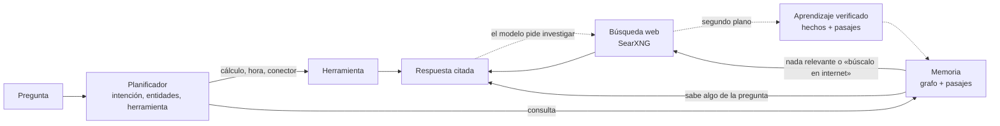

# SynaptoCore

**Memoria cognitiva local: un grafo de conocimiento que aprende, verifica lo que aprende, olvida lo que no usa y responde citando de dónde lo sabe.**

[](https://github.com/yemsy26/SynaptoCore/actions/workflows/ci.yml)
[](LICENSE)


SynaptoCore es un servidor escrito en Rust que da a un modelo de lenguaje local una memoria a largo plazo. Guarda el conocimiento como relaciones (`sujeto → relación → objeto`) en SQLite, junto con el texto de donde salió. Cuando no sabe algo, lo investiga en la web, responde citando las fuentes y aprende en segundo plano solo lo que puede verificar. Todo corre en tu máquina: el modelo (vía [Ollama](https://ollama.com)), el buscador ([SearXNG](https://docs.searxng.org)) y la base de datos.

---

## Contenido

- [Características](#características)
- [Cómo funciona](#cómo-funciona)
- [Requisitos](#requisitos)
- [Instalación](#instalación)
- [Primeros pasos](#primeros-pasos)
- [Guía de uso](#guía-de-uso)
- [Configuración](#configuración)
- [Desarrollo](#desarrollo)
- [Solución de problemas](#solución-de-problemas)
- [Contribuir](#contribuir)
- [Licencia](#licencia)

---

## Características

- **Memoria primero, web después.** Si su memoria sabe algo de lo que preguntas, responde con ella y refuerza lo que usó. Solo busca en la web si la memoria no tiene nada al respecto, si el modelo indica que no le alcanza o si se lo pides («búscalo en internet»); entonces responde citando las fuentes `[n]` y aprende lo verificado. Sin buscador disponible, responde con conocimiento general y lo marca como no verificado.
- **Te recuerda a ti.** Lo que cuentas de ti mismo («Me llamo Ana», «Trabajo en ventas») queda en tu perfil de la memoria. Las preguntas sobre ti («¿cómo me llamo?», «¿qué sabes de mí?») se responden con eso y nunca se buscan en la web; si aún no se lo has contado, te lo dice.
- **Memoria con procedencia.** Cada relación recuerda de dónde vino (enseñada por ti, investigada, deducida, importada) y su fuente. Lo enseñado no se olvida; lo deducido sin supervisión caduca en semanas si nadie lo usa.
- **Memoria de pasajes.** Guarda el texto de las fuentes y de lo que enseñas, para explicar con detalle y citar de dónde sale cada dato.
- **Investigación profunda.** Divide un objetivo en preguntas, reúne fuentes, propone hipótesis y las contrasta con evidencias a favor y en contra antes de concluir.
- **Aprendizaje autónomo.** En reposo, un proceso en segundo plano detecta conceptos relacionados sin conectar, formula una pregunta, busca evidencia y consolida solo lo verificado.
- **Cálculo exacto.** Las preguntas numéricas van a una calculadora de precisión arbitraria, a un verificador de conjeturas y a un buscador de fórmulas de sucesiones; el modelo nunca rehace las cuentas.
- **Conectores sin código.** Cualquier API HTTP (ERP, CRM, inventario) se declara en un archivo JSON y el asistente puede consultarla.
- **Importación por lotes.** Carga cientos de miles de relaciones desde JSONL (por ejemplo, desde Wikidata) y deshace un lote entero si hace falta.
- **Varios cerebros.** Usa modelos de Ollama y de servidores compatibles con OpenAI (LM Studio, Bionic, llama.cpp) a la vez: uno rápido para planificar y extraer, y otro profundo para responder e investigar. Lo que se le pide a cada uno depende de su tamaño, para que un modelo pequeño no quede desbordado. Se cambian desde el panel sin reiniciar.
- **Interfaces.** Panel web en tiempo real, API REST con respuestas en streaming (SSE), telemetría por WebSocket y una CLI (`sc`).

## Cómo funciona



1. **Planificador.** Una sola llamada al modelo decide la intención (consultar o aprender), reescribe la pregunta con el historial de la conversación, extrae las entidades y elige una herramienta si hace falta.
2. **Memoria.** Recupera las relaciones del grafo y los pasajes relevantes (búsqueda semántica con embeddings y búsqueda de texto completo).
3. **Investigación.** Busca en SearXNG y responde citando las fuentes solo si la memoria no nombra nada de lo preguntado, si el modelo indica que lo que recuerda no alcanza, o si pides expresamente buscar en internet. Si la memoria sabe algo, responde con ella y refuerza lo que usó.
4. **Aprendizaje.** En segundo plano extrae hechos de las fuentes, los valida contra ellas y consolida solo los verificados. El texto de las fuentes se guarda como pasajes.
5. **Olvido.** Cada hora las relaciones y los pasajes que no se usan pierden fuerza según su procedencia; lo que cae por debajo del umbral se elimina.

La arquitectura interna está documentada en [ARCHITECTURE.md](ARCHITECTURE.md).

## Requisitos

| Componente | Necesario | Notas |
|------------|-----------|-------|
| [Rust](https://rustup.rs) estable | Sí | Desarrollado con Rust 1.94. |
| [Ollama](https://ollama.com) | Sí, para respuestas reales | Usa la GPU automáticamente si la hay. Sin Ollama el servidor arranca en modo demostración. |
| Modelo `qwen3.5:2b-q4_K_M` | Sí | 1,9 GB. Se puede usar otro modelo de Ollama con `OLLAMA_MODEL`. |
| [LM Studio](https://lmstudio.ai) u otro servidor compatible con OpenAI | Opcional | Para usar más modelos como cerebros (ver [Cerebros](#cerebros)). |
| [Docker](https://www.docker.com) | Recomendado | Para ejecutar SearXNG, el buscador que permite investigar y verificar. |
| Python 3 | Opcional | Solo para el script que genera datos desde Wikidata. |

- **Sistemas operativos:** Windows 10/11, Linux y macOS.
- **Memoria:** 4 GB de RAM libres como mínimo (el modelo de 2B más el servidor).
- **Disco:** unos 3 GB para la compilación, más el modelo de Ollama.
- **Red:** la primera compilación descarga ONNX Runtime, y el primer arranque descarga el modelo de embeddings multilingüe (~120 MB). Después funciona sin conexión, salvo las búsquedas web.

## Instalación

### 1. Instala las herramientas

```bash
# Rust (Linux/macOS; en Windows descarga rustup-init.exe desde https://rustup.rs)
curl --proto '=https' --tlsv1.2 -sSf https://sh.rustup.rs | sh

# Ollama: descárgalo desde https://ollama.com y luego baja el modelo
ollama pull qwen3.5:2b-q4_K_M
```

### 2. Clona el repositorio

```bash
git clone https://github.com/yemsy26/SynaptoCore.git
cd SynaptoCore
```

### 3. Configura el entorno

```bash
cp .env.example .env          # PowerShell: Copy-Item .env.example .env
```

Los valores por defecto funcionan para una instalación local. Las variables disponibles se explican en [Configuración](#configuración).

### 4. Levanta el buscador (recomendado)

SearXNG permite que SynaptoCore investigue lo que no sabe y verifique lo que aprende. El repositorio incluye una configuración lista para usar:

```bash
docker run -d --name searxng-brain -p 8888:8080 --restart unless-stopped \
  -v "$(pwd)/searxng-settings.yml:/etc/searxng/settings.yml" \
  -v "$(pwd)/searxng-limiter.toml:/etc/searxng/limiter.toml" \
  searxng/searxng
```

En PowerShell, sustituye `$(pwd)` por `${PWD}` y las barras invertidas finales por acentos graves (`` ` ``).

> La `secret_key` de `searxng-settings.yml` es un valor de ejemplo. Si vas a exponer SearXNG fuera de tu equipo, sustitúyela por una clave propia.

### 5. Arranca SynaptoCore

**Windows (recomendado):** haz doble clic en `start_brain.bat`. El script comprueba Rust, Ollama y Docker, levanta SearXNG, compila, arranca el servidor y abre el panel en el navegador. También puedes usar `.\start_brain.ps1` desde PowerShell.

**Linux, macOS o arranque manual:**

```bash
set -a; source .env; set +a      # el servidor no lee .env por sí mismo
cargo run --release --bin synaptocore
```

La primera compilación tarda varios minutos. Cuando veas `SynaptoCore API escuchando en http://127.0.0.1:8080`, abre **http://localhost:8080**.

### 6. Comprueba que funciona

```bash
curl http://localhost:8080/health
```

```json
{ "status": "ok", "node_count": 23, "edge_count": 31, "avg_weight": 0.91, "passage_count": 0, "version": "0.17.0" }
```

En la consola del servidor debe aparecer `Backend LLM: Ollama (qwen3.5:2b-q4_K_M)`. Si aparece `ServerMock`, Ollama no está disponible: revisa [Solución de problemas](#solución-de-problemas).

## Primeros pasos

Abre el panel en **http://localhost:8080** y escribe en el chat.

**1. Enséñale algo.** Las afirmaciones y las peticiones de memorizar se aprenden:

> Memoriza que la sucursal del centro abre de lunes a viernes de 9 a 18 h y los sábados de 10 a 14 h. La responsable es Marta Ruiz.

SynaptoCore extrae las relaciones, las añade al grafo y guarda tu texto tal cual.

**2. Pregúntale por ello.** Responde desde su memoria y cita de dónde lo sabe:

> ¿A qué hora abre la sucursal del centro los sábados?
>
> *La sucursal del centro abre los sábados de 10 a 14 h [1].* — Fuente: *Lo que me enseñaste*

**3. Pregúntale algo que no sabe.** Lo investiga en la web, responde con las fuentes enlazadas y aprende en segundo plano:

> ¿Qué es el grafeno?

La próxima vez que preguntes por el grafeno responderá desde su memoria, citando las mismas fuentes, sin volver a buscar. Si quieres información actualizada aunque ya lo sepa, pídelo: «Busca en internet las novedades del grafeno».

**4. Pídele un cálculo.** El resultado es exacto y muestra qué se calculó:

> ¿Cuántas combinaciones de 6 números hay en una lotería de 49?
>
> *C(49,6) = 13983816 (exacto)*

**5. Lanza una investigación profunda.** Pulsa **Investigar** en el panel, escribe un objetivo (por ejemplo, *¿Quién descubrió la penicilina y en qué año?*) y sigue en vivo las preguntas, las fuentes y las hipótesis.

## Guía de uso

### Panel web

En `http://localhost:8080` encontrarás:

- **Chat** con respuestas en streaming, el origen de cada respuesta (memoria, web, herramienta, conocimiento general) y sus fuentes enlazadas.
- **Grafo** de conocimiento interactivo; cada relación muestra su procedencia.
- **Métricas**: conceptos, relaciones, peso medio y pasajes guardados.
- **Actividad** del aprendizaje autónomo en tiempo real.
- **Investigar**: lanza y sigue investigaciones profundas.

### API REST

Todas las rutas están bajo `http://localhost:8080`. La referencia completa, con ejemplos de petición y respuesta, está en [docs/API.md](docs/API.md).

| Método | Ruta | Uso |
|--------|------|-----|
| `GET` | `/health` | Estado y métricas |
| `POST` | `/api/v1/chat` | Chat con respuesta en streaming (SSE): aprende o responde según el mensaje |
| `POST` | `/api/v1/query` | Consulta con respuesta completa en JSON |
| `POST` | `/api/v1/learn` | Enseña un texto |
| `GET` | `/api/v1/graph/all` | Instantánea del grafo |
| `GET` | `/api/v1/graph/neighbors/{id}` | Vecinos de un concepto |
| `GET` `POST` | `/api/v1/investigations` | Lista o inicia investigaciones profundas |
| `GET` | `/api/v1/investigations/{id}` | Estado completo de una investigación |
| `POST` | `/api/v1/investigations/{id}/cancel` | Cancela una investigación |
| `GET` | `/api/v1/passages` | Pasajes guardados con su procedencia |
| `DELETE` | `/api/v1/passages/{id}` | Borra un pasaje |
| `POST` | `/api/v1/federation/export` | Exporta las novedades de las últimas 24 h como delta `.synapse` |
| `GET` | `/ws/subconscious` | Telemetría en tiempo real (WebSocket) |

Ejemplo rápido:

```bash
curl -X POST http://localhost:8080/api/v1/query \
  -H "Content-Type: application/json" \
  -d '{"prompt": "¿Qué es el grafeno?"}'
```

```json
{
  "response": "El grafeno es una lámina de carbono de un átomo de grosor [1]...",
  "session_id": "8f0c…",
  "answered_from": "web",
  "sources": [{ "n": 1, "title": "Grafeno - Wikipedia", "url": "https://es.wikipedia.org/wiki/Grafeno" }]
}
```

Envía el mismo `session_id` en las siguientes peticiones para mantener el hilo: «¿Y para qué sirve?» se entiende como «¿Para qué sirve el grafeno?».

### CLI `sc`

Cliente de terminal para un servidor en marcha:

```bash
cargo install --path . --bin sc

sc health                                   # estado del servidor
sc query "¿Qué es el cortisol?"             # consulta
sc learn "Rust fue creado por Graydon Hoare en Mozilla."
sc learn --file notas.txt                   # enseña un archivo de texto
sc export --out respaldo.synapse            # delta de las últimas 24 h
sc watch                                    # actividad en tiempo real (Ctrl+C para salir)
```

Para usar otro servidor: `SC_HOST=http://192.168.1.50:8080 sc health` (URL completa, con `http://`).

### Importar conocimiento

`synaptocore importar` carga relaciones desde un archivo JSONL sin pasar por el modelo. Cada línea es una relación; `weight` es opcional (0,8 por defecto):

```json
{"subject": "Ecuador", "relation": "tiene_capital", "object": "Quito", "weight": 0.9}
```

```bash
synaptocore importar paises.jsonl              # lote «paises» (nombre del archivo)
synaptocore importar datos.jsonl --lote erp    # nombre de lote explícito
synaptocore importar --lista                   # lotes importados
synaptocore importar --deshacer paises         # retira el lote completo
```

- Ejecútalo en la carpeta donde está `synaptocore_memory.db` (la del servidor). Si el servidor está en marcha, reinícialo para que indexe los conceptos nuevos.
- Cada concepto se une al que ya existe con el mismo nombre (sin distinguir tildes ni mayúsculas).
- Lo importado no se olvida, y una relación que ya existía no se modifica: deshacer un lote nunca borra lo aprendido por otra vía.
- Si la importación se interrumpe, repetir el comando continúa donde se quedó.

`scripts/wikidata_tripletas.py` genera ese formato desde Wikidata, sin dependencias:

```bash
python scripts/wikidata_tripletas.py --preset paises -o paises.jsonl
python scripts/wikidata_tripletas.py --clase Q11344 --propiedades P61:descubierto_por -o elementos.jsonl
```

### Cerebros

El botón **Cerebros** del panel muestra los motores encontrados (Ollama, LM Studio en el puerto 1234 y Bionic en el 1235) con sus modelos, su tamaño, su compresión y si están cargados. Hay dos funciones:

| Cerebro | Qué hace | Conviene |
|---------|----------|----------|
| Rápido | Planifica cada mensaje, extrae hechos, valida y mueve el aprendizaje en segundo plano. | Un modelo pequeño y rápido (2-4B). |
| Profundo | Redacta las respuestas e investiga a fondo. | El modelo más capaz que quepa en tu equipo. |

Cada cerebro tiene un **nivel** que sale de su tamaño y decide cuánto se le pide:

| Nivel | Modelos | Respuestas de hasta | Pasajes en el prompt | Rondas al investigar |
|-------|---------|---------------------|----------------------|----------------------|
| Ligero | 4B o menos | 384 tokens | 3 | 3 |
| Medio | 5 a 14B | 768 tokens | 5 | 3 |
| Avanzado | 15B o más | 1536 tokens | 8 | 4 |

Un modelo muy comprimido (1-2 bits por peso) baja un nivel, y el nivel se puede fijar a mano. **Probar** comprueba un cerebro antes de usarlo: si devuelve el JSON que necesitan el planificador y la extracción, si responde en streaming, su velocidad y si razona siempre. **Usar estos cerebros** los cambia sin reiniciar y guarda la elección en `cerebros.json`.

Funciona con modelos que razonan: se les pide no razonar cuando lo admiten y, a los que razonan siempre, se les da más margen y se descarta el razonamiento de la respuesta. Si al arrancar un cerebro guardado no está disponible (por ejemplo, LM Studio cerrado), se usa el modelo de `OLLAMA_MODEL` y se avisa en la consola. En un equipo con poca memoria de vídeo, un cerebro profundo grande responde con más calidad pero tarda más.

### Investigación profunda

Para preguntas que piden más que un dato. Trabaja en segundo plano, por rondas:

1. **Preguntas:** divide el objetivo en preguntas de búsqueda; en cada ronda pregunta por lo que sigue sin resolver.
2. **Fuentes:** busca cada pregunta y numera las fuentes `[n]`.
3. **Hipótesis:** propone respuestas posibles.
4. **Evidencias:** busca a favor y en contra de cada hipótesis y la juzga como *apoyada*, *refutada* o *sin confirmar*.
5. **Conclusión:** cuando una hipótesis queda apoyada con certeza ≥ 0,7, o se agotan las rondas (3 por defecto, hasta 5), redacta la conclusión con citas y aprende lo verificado.

Un veredicto solo cuenta si cita fuentes que el sistema le mostró, con certeza suficiente y sin fuentes en conflicto; ante la duda queda *sin confirmar*. Solo corre una investigación a la vez, su estado se guarda tras cada paso y el chat mantiene la prioridad sobre el modelo.

### Conectores externos

Cualquier sistema con API HTTP se conecta declarándolo en `conectores.json` (plantilla: `conectores.example.json`):

```json
[
  {
    "name": "Inventario",
    "description": "Consulta el stock disponible y el precio de un producto.",
    "method": "GET",
    "url": "http://localhost:9000/api/v1/inventory?producto={producto}",
    "headers": { "Authorization": "Bearer ${ERP_API_TOKEN}" },
    "params": { "producto": "Nombre o SKU del producto" }
  }
]
```

El asistente ve el nombre y la descripción de cada conector y solo rellena sus parámetros; nunca elige URLs. Los secretos se guardan en variables de entorno y se citan como `${NOMBRE}`. Con `POST`, los parámetros se envían como JSON. Un conector mal declarado se omite al arrancar, con su motivo, y el resto sigue funcionando.

### Herramientas matemáticas

| Pregunta | Respuesta |
|----------|-----------|
| ¿Cuánto es 2^100? | `2^100 = 1267650600228229401496703205376 (exacto)` |
| ¿Es primo 2^61-1? | `esprimo(2^61-1) = verdadero` |
| Factoriza 360 | `360 = 2^3 × 3^2 × 5` |
| Comprueba que n²+n+41 es primo para n de 0 a 100 | `«esprimo(n^2+n+41)» es falsa: falla en n = 40 … No es primo: 1681 = 41^2.` |
| ¿Qué número sigue en 2, 6, 12, 20, 30? | `… los siguientes términos serían 42, 56, 72. Fórmula: a(n) = n^2 + n …` |

- **Calculadora:** enteros de cualquier tamaño y fracciones exactas (`0.1 + 0.2 == 0.3` es verdadero). Operadores `+ - * / ^ ! %`, comparaciones y `and`/`or`/`not`; funciones `raiz`, `abs`, `piso`, `techo`, `redondear`, `mcd`, `mcm`, `C(n,k)`, `fib`, `esprimo`, `factoriza`, `suma(k^2,k,1,10)`, `producto(k,k,1,5)`, y `sin cos tan asin acos atan ln log exp` con `pi` y `e` (marcadas como aproximadas).
- **Conjetura:** comprueba una afirmación sobre `n` en un rango (1–1000 por defecto, hasta 100 000 valores) y da el primer contraejemplo. Si se cumple, lo presenta como una comprobación numérica, no como una demostración.
- **Sucesión:** busca una fórmula polinómica, geométrica o de recurrencia que confirmen los términos dados y predice los tres siguientes.

La respuesta repite la expresión evaluada, así que un planteamiento equivocado queda a la vista. Límites: 400 caracteres por expresión, unas 120 000 cifras por número y 3 s por cálculo (6 s por conjetura).

### Memoria de pasajes

Además de los hechos sueltos, SynaptoCore guarda el texto del que salen:

- **Fuentes investigadas:** el fragmento de cada fuente, con su título, su URL y la pregunta que llevó a ella.
- **Lo que enseñas:** tu texto tal cual, de forma permanente, aunque el modelo no consiga extraer hechos de él.

Al responder desde la memoria, hasta tres pasajes relevantes acompañan a la pregunta y la respuesta los cita como fuentes. La relevancia combina similitud semántica y coincidencia de palabras, para no perder términos poco comunes. Puedes revisarlos con `GET /api/v1/passages` y borrar uno equivocado con `DELETE /api/v1/passages/{id}`. Los pasajes investigados que no se usan en unos 13 meses se olvidan; los enseñados, nunca.

### Federación

`POST /api/v1/federation/export` (o `sc export`) genera un delta `.synapse` en JSON con los conceptos y relaciones de las últimas 24 horas, útil como respaldo incremental o para compartir conocimiento entre instancias. La importación de deltas está implementada en el módulo `federated_memory`, pero todavía no se expone por la API.

## Configuración

El servidor lee estas variables de entorno (los lanzadores de Windows las cargan desde `.env`):

| Variable | Por defecto | Descripción |
|----------|-------------|-------------|
| `OLLAMA_HOST` | `http://localhost:11434` | URL de Ollama. |
| `OLLAMA_MODEL` | `qwen3.5:2b-q4_K_M` | Modelo de Ollama que se usa mientras no se elijan otros cerebros. |
| `SYNAPTOCORE_OPENAI_URLS` | `http://localhost:1234,http://localhost:1235` | Servidores compatibles con OpenAI donde buscar cerebros (LM Studio, Bionic, llama.cpp), separados por comas. |
| `SYNAPTOCORE_BRAINS` | `cerebros.json` | Archivo donde se guarda la elección de cerebros. |
| `SEARXNG_URL` | *(sin definir)* | URL de SearXNG. Sin ella no hay búsquedas web ni aprendizaje autónomo, y lo que no esté en memoria se responde como conocimiento general no verificado. |
| `SYNAPTOCORE_PORT` | `8080` | Puerto del servidor. Escucha solo en `127.0.0.1`. |
| `SYNAPTOCORE_CONNECTORS` | `conectores.json` | Archivo de conectores externos. |
| `FASTEMBED_CACHE_DIR` | `.fastembed_cache` | Carpeta del modelo de embeddings. |
| `SC_HOST` | `http://127.0.0.1:8080` | Servidor al que se conecta la CLI `sc`. |

**Datos.** Toda la memoria vive en `synaptocore_memory.db` (SQLite), en la carpeta desde la que arrancas el servidor. Para respaldarla, copia el archivo con el servidor detenido o usa `sqlite3 synaptocore_memory.db ".backup respaldo.db"`. Para empezar de cero, detén el servidor y borra `synaptocore_memory.db*`.

## Desarrollo

### Estructura del proyecto

```
SynaptoCore/
├── src/
│   ├── main.rs              # arranque, ciclos de fondo y subcomando `importar`
│   ├── api_server.rs        # API REST, SSE y WebSocket (Axum)
│   ├── llm_bridge.rs        # planificador, recuperación de contexto y respuesta
│   ├── brains.rs            # cerebros: catálogo, nivel, alcance y cambio en caliente
│   ├── ollama_backend.rs    # motor Ollama
│   ├── openai_backend.rs    # motor compatible con OpenAI (LM Studio, Bionic)
│   ├── memory_graph.rs      # grafo en SQLite, índice vectorial y olvido
│   ├── memory_graph/
│   │   └── passages.rs      # memoria de pasajes (vector + FTS5)
│   ├── subconscious.rs      # aprendizaje autónomo en reposo
│   ├── truth_filter.rs      # SearXNG y validación de afirmaciones
│   ├── research.rs          # aprendizaje a partir de fuentes
│   ├── investigation.rs     # investigación profunda
│   ├── math_tools.rs        # calculadora, conjeturas y sucesiones
│   ├── connectors.rs        # conectores HTTP declarativos
│   ├── importer.rs          # importación por lotes
│   ├── dashboard.html       # panel web (incrustado en el binario)
│   └── bin/sc.rs            # CLI
├── scripts/                 # generador de datos desde Wikidata
├── docs/API.md              # referencia de la API
├── start_brain.bat / .ps1   # lanzadores para Windows
└── searxng-*.{yml,toml}     # configuración de SearXNG
```

### Pruebas

```bash
cargo test                          # suite completa (con embeddings)
cargo test --no-default-features    # sin ONNX Runtime: más rápido, sin descargas
cargo test passages                 # un módulo concreto
```

Las pruebas usan modelos simulados y bases en memoria: no necesitan Ollama, SearXNG ni red. Las que dependen de servicios reales están marcadas con `#[ignore]`; por ejemplo, la calibración de relevancia de pasajes con el modelo de embeddings real:

```bash
cargo test passage_similarity_calibration -- --ignored --nocapture
```

### Compilación de producción

```bash
cargo build --release
# target/release/synaptocore(.exe)  servidor
# target/release/sc(.exe)           CLI
```

El perfil `release` usa LTO completo, una sola unidad de generación de código y `panic = "abort"`.

### Features de Cargo

| Feature | Por defecto | Descripción |
|---------|-------------|-------------|
| `embeddings` | Sí | Búsqueda semántica con fastembed y ONNX Runtime. Sin ella, la recuperación es léxica. |
| `llama-backend`, `cuda`, `vulkan` | No | Compilan los enlaces con llama.cpp. Experimental: el servidor usa Ollama como motor. |

## Solución de problemas

**El servidor dice `Usando ServerMock`.** No encuentra Ollama o el modelo. Comprueba que Ollama está en marcha (`ollama list`), que el modelo está descargado (`ollama pull qwen3.5:2b-q4_K_M`) y que `OLLAMA_HOST` es correcto.

**Las respuestas llevan «Según mi conocimiento general (no verificado)».** No hay buscador: define `SEARXNG_URL` y comprueba que SearXNG responde en `http://localhost:8888`.

**SearXNG no devuelve resultados.** Algunos motores se suspenden temporalmente por exceso de peticiones. Activa más motores en `searxng-settings.yml` y reinicia el contenedor (`docker restart searxng-brain`).

**El puerto 8080 está ocupado.** Arranca con otro puerto: `SYNAPTOCORE_PORT=8081`.

**La primera compilación o el primer arranque tardan.** Es normal: se compilan las dependencias y se descargan ONNX Runtime y el modelo de embeddings (unos 120 MB, una sola vez).

**Sigue comportándose como antes de actualizar.** El servidor que ya estaba en marcha usa el ejecutable con el que arrancó. Ciérralo y vuelve a abrir `start_brain.bat`, que recompila si el código cambió.

**Investigó en la web algo que yo le había enseñado.** Comprueba que al enseñarlo respondió «He integrado esta información…»: si contestó como a una pregunta, no lo aprendió como enseñanza (reformúlalo como afirmación o empieza por «Memoriza que…»). Con preguntas muy indirectas («¿qué uso con poca gráfica?» en lugar de nombrar BitNet o la VRAM), la memoria puede no reconocer de qué hablas: nombrar el concepto ayuda.

**Una respuesta usa un dato equivocado de la memoria.** Busca el pasaje en `GET /api/v1/passages` y bórralo con `DELETE /api/v1/passages/{id}`.

## Contribuir

Las contribuciones son bienvenidas. Lee [CONTRIBUTING.md](CONTRIBUTING.md) para preparar el entorno, las convenciones del código y cómo proponer cambios. Para reportar una vulnerabilidad, consulta [SECURITY.md](SECURITY.md).

## Licencia

Distribuido bajo la licencia MIT. Consulta [LICENSE](LICENSE).

## Autor

**Ramón Burgos** — [@yemsy26](https://github.com/yemsy26)
